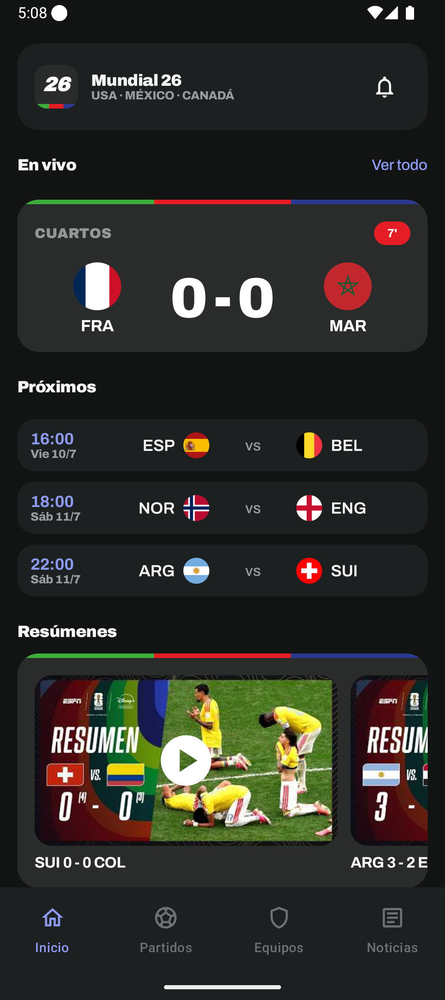
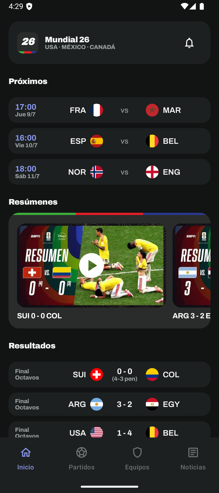
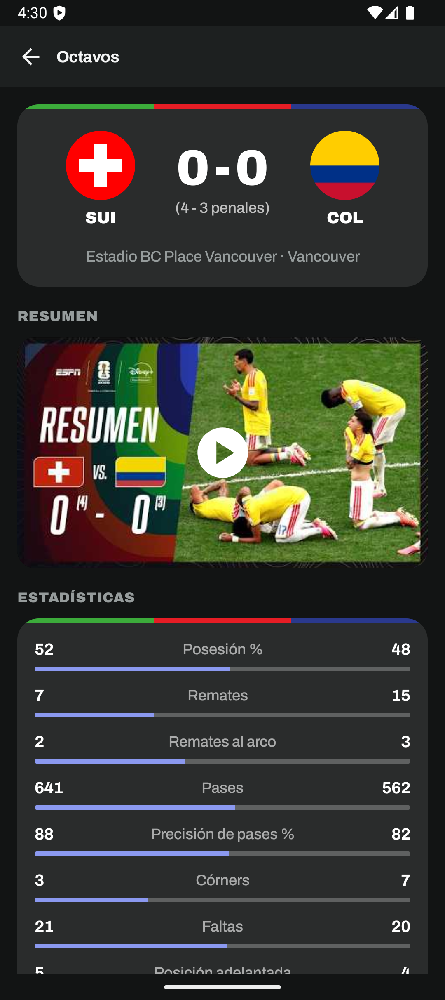
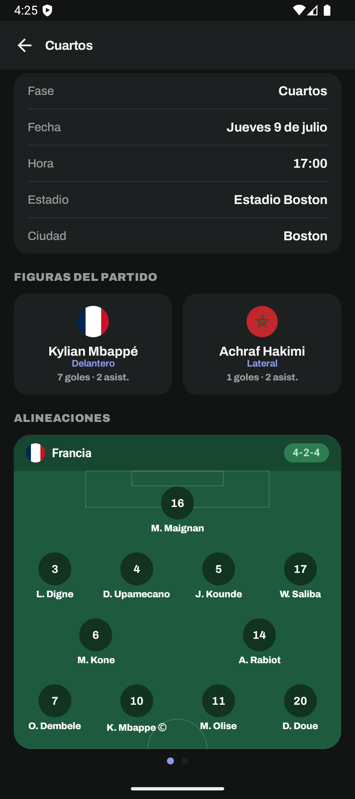
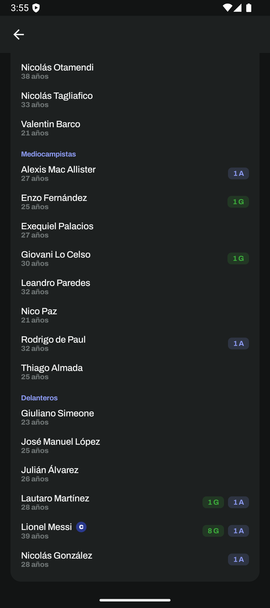
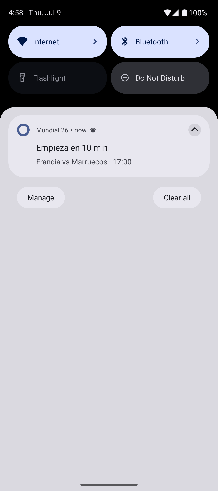

# Mundial 26 ⚽

App Android nativa para seguir la **Copa Mundial de la FIFA 2026** (Estados Unidos · México · Canadá). Datos reales del torneo, partidos en vivo, resúmenes en video y notificaciones de goles.

## Capturas

<p align="center">
  
  
  
</p>
<p align="center">
  
  
  
</p>

## Funcionalidades

- **Inicio**: partidos en vivo con minuto y marcador, próximos partidos, resultados, carrusel de **resúmenes en video** embebidos (ESPN/YouTube), llaves, posiciones con mejores terceros, líderes del torneo y noticias.
- **Partidos en vivo**: marcador y minuto oficial FIFA (con tiempo añadido), estadísticas, timeline de eventos (goles, tarjetas, cambios) y refresco automático cada 30 s + swipe-down para refrescar.
- **Detalle de partido**: previa con probabilidad de victoria (ranking FIFA) y figuras de cada equipo; resumen en video al finalizar; **alineaciones confirmadas en la cancha** (XI titular por posición, dorsal, formación y capitán) con swipe para cambiar de equipo.
- **Notificaciones**: recordatorio 10 min antes del partido y **goles en vivo** (jugador, país y minuto — el aviso llega al instante por cambio de marcador y se actualiza con el goleador). Tocar la notificación abre el partido.
- **Equipos**: las 48 selecciones con ranking, grupos con clasificados pintados, llaves de eliminatorias, y ficha de cada equipo con títulos mundiales, DT, estrella y **plantel completo** (goles, asistencias, tarjetas, capitán y lesionados).
- **Jugadores**: ficha con estadísticas del Mundial (goles, asistencias, tarjetas), perfil FIFA (partidos, altura, peso, pie hábil) y club actual.
- **Noticias**: feed en español (Google News RSS) con imagen de la fuente.

## Stack

- **Kotlin + Jetpack Compose (Material 3)** — UI 100 % declarativa, tema oscuro único
- **MVVM + Repository**, DI manual (`AppContainer`), **Room** para caché offline
- **Retrofit/OkHttp + kotlinx.serialization**
- **Media3/ExoPlayer** (video intro) y **android-youtube-player** (resúmenes embebidos)
- **AlarmManager + Foreground Service** para recordatorios y goles en vivo

## Fuentes de datos

| Fuente | Uso |
|---|---|
| [football-data.org](https://www.football-data.org/) | Fixture, resultados, posiciones, planteles |
| API pública de FIFA | En vivo (minuto/marcador), timeline, alineaciones, estadísticas oficiales |
| [openfootball](https://github.com/openfootball) | Eventos de respaldo |
| Google News RSS | Noticias en español |
| YouTube (scraping + oEmbed) | Resúmenes en video embebidos |

## Compilar

1. Cloná el repo y abrilo en Android Studio.
2. Agregá tu token de football-data.org en `local.properties`:
   ```properties
   FOOTBALL_DATA_TOKEN=tu_token
   ```
3. Corré `./gradlew :app:assembleDebug` o directamente desde Android Studio (minSdk 26).
